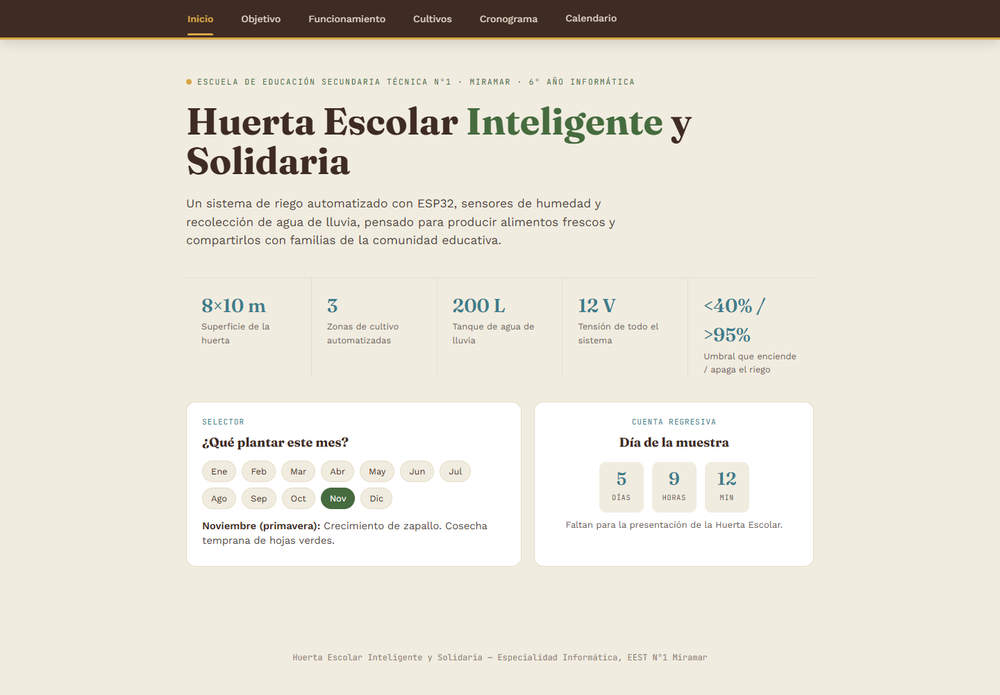
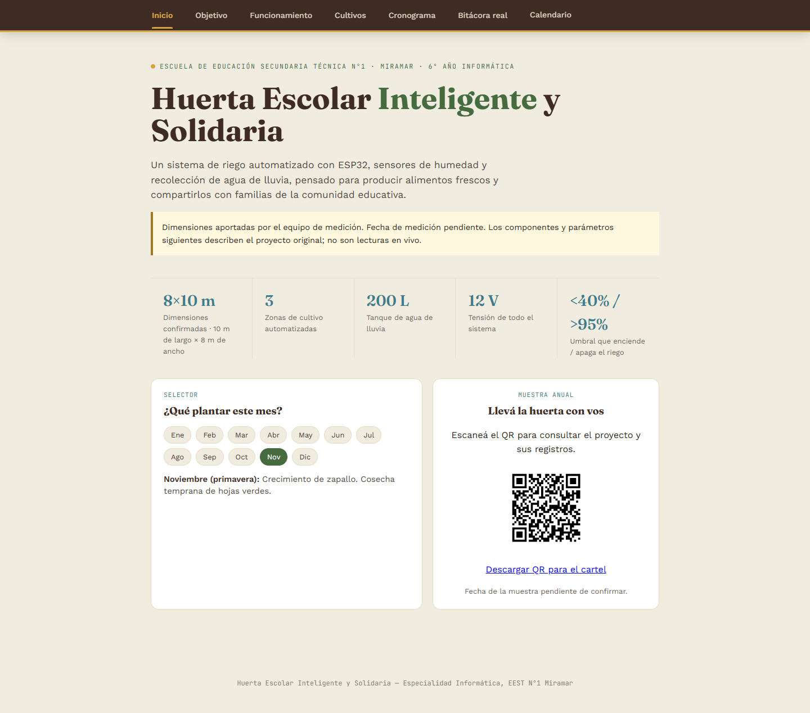

# Huerta escolar — TP 3

Página para la muestra anual: https://moreamateo.github.io/huerta_moreaaa/

## Antes y después

[Captura en celular](despues-movil.png) · [QR para el cartel](qr.png)

Tres puntos flojos encontrados en la versión anterior (commit `77723ac`):
1. Humedad simulada y cronograma de riego calculado sin registros de campo.
2. Fecha de muestra fija sin una fuente documentada.
3. No existía una bitácora con fecha, fuente y equipo responsable de cada observación.

## Datos y procedencia

`datos.json` contiene dimensiones aportadas por el usuario: **10 m de largo y 8 m de ancho**. El usuario confirmó expresamente el largo de 10 m. Responsable público: **equipo de medición**. Los nombres se mantienen fuera de la entrega por la regla de privacidad del TP. **Falta informar la fecha de medición**; no se reemplazó por la fecha de edición del sitio.

El material visual aportado NO se incluye ni se publica, por pedido del usuario. No se incorporaron sus cotas parciales contradictorias. La ilustración del brote es decorativa, no una foto de la huerta. Las fotos heredadas no se muestran porque su procedencia no está acreditada.

`registros` está vacío: no recibimos observaciones fechadas de siembra, crecimiento o cosecha. No se inventaron valores ni fechas. La línea de tiempo y el filtro por cultivo se completan automáticamente cuando el equipo agrega registros revisados.

Cada registro debe tener estos campos de texto no vacíos:

| Campo | Contenido requerido |
|---|---|
| cultivo | Cultivo observado |
| fecha | Fecha real en formato AAAA-MM-DD |
| equipo | Código del grupo, sin nombres personales |
| fuente | Referencia concreta al cuaderno o ficha de campo |
| observacion | Hecho observado; incluir valor y unidad si hubo medición |

Agregar objetos dentro de `registros` en `datos.json`. Mostrar primero los registros al profesor. El sitio rechaza archivos con registros incompletos o fechas inválidas; esto no reemplaza la revisión humana de su veracidad.

## Skills usados

- **frontend-design**, de Anthropic: [SKILL.md completo](https://github.com/anthropics/skills/blob/main/skills/frontend-design/SKILL.md). Se leyó completo y se aplicó como guía de diseño. No pide claves, credenciales ni ejecutar comandos. Se usaron sus criterios de composición, tipografía, accesibilidad y estados vacíos. Fuente: repositorio oficial de Anthropic. Consultado durante esta sesión.
- **Sites**, de OpenAI, disponible en el entorno de Codex: guía local para diseño responsive y verificación. La publicación de este proyecto usa GitHub Pages.

Plan visual: verde bosque `#254d36`, blanco vegetal `#fcfdf8`, verde claro `#e5edcf`, tinta `#20362b`, línea `#c4d2bf`; Georgia para títulos y Arial para lectura. Composición: apertura con ilustración de brote, dimensiones, bitácora, método y QR. Sin fotos ficticias ni contadores que aparenten datos reales.

**Pendiente del paso de Claude:** el skill se consultó aquí, en Codex. No se afirma que se instaló en Claude ni que el profesor supervisó su carga. Si la evaluación exige uso efectivo en Claude, el equipo debe realizarlo y registrar la versión exacta que indique esa aplicación.

## IA usada

OpenAI Codex, basado en GPT-6. Esta sesión no expone una identificación más precisa de la versión; no se inventa un número de versión de Claude.

## Auditoría y correcciones

- Se eliminaron de la página pública la humedad aleatoria y el riego calculado: podían confundirse con observaciones reales. No se conoce la autoría original, por lo que no se atribuyen esos errores a una IA sin evidencia.
- Se retiró la cuenta regresiva con fecha de muestra no confirmada.
- Corrección de esta iteración asistida por IA: se había incorporado el plano aportado como imagen pública; el usuario aclaró que no debía mostrarse. Se quitó el archivo y su referencia antes de publicar.
- Corrección de esta iteración asistida por IA: inicialmente se mantuvo el largo como pendiente por la contradicción entre cotas del plano. Tras la confirmación del usuario, se registró 10 m y se descartaron las cotas parciales como datos utilizables. Es una corrección por aclaración del usuario, no una medición nueva.

Otra corrección de la IA en esta sesión: la captura llamada móvil se había tomado al terminar la prueba de 768 px. Se detectó al inspeccionarla y se volvió a generar a 390 px. Las correcciones son de Codex; si se exigen errores observados en Claude, deben documentarse durante ese trabajo.

## Verificación

Pruebas en Edge automatizado: escritorio de 1440 px y anchos de 360, 390 y 768 px, sin desbordes horizontales. Comprobados: estado vacío, carga de registros, filtro, texto tratado como texto (no HTML ejecutable), error por registro incompleto y ausencia de errores de JavaScript. Los datos sintéticos de prueba se inyectaron solo en memoria y no se publicaron. Falta probar en un teléfono físico.

Para ejecutar localmente: `python -m http.server 8765`, y abrir `http://localhost:8765`. Abrir el HTML directamente como archivo puede impedir la carga de JSON.

## Publicación y pendientes para la muestra

GitHub Pages debe servir `main` desde la raíz. El QR apunta a la URL pública indicada arriba. Los enlaces de las páginas antiguas llevan al nuevo inicio.

- [x] Capturas antes/después y QR.
- [x] Diseño adaptable, dimensiones aportadas y bitácora filtrable.
- [x] Fuente del skill y revisión de sus instrucciones.
- [ ] Informar la fecha de medición y revisar los datos con el profesor.
- [ ] Agregar observaciones reales con fecha y fuente.
- [ ] Cargar y usar el skill en Claude con el profesor, si es requisito obligatorio.
- [ ] Completar los errores efectivamente observados en Claude y probar en un celular físico.

## Guion para ensayar

“Mejoramos la página de la huerta para que cada observación tenga una fuente. El equipo informó un espacio de 10 metros de largo por 8 de ancho; todavía falta completar la fecha de esa medición. Sacamos la humedad simulada y los riegos que no venían de observaciones reales. Preparamos una bitácora que muestra los registros por fecha y permite filtrar por cultivo. La próxima tarea es cargar lo medido en la huerta y revisarlo con el profesor. El código QR permite consultar la página durante la muestra.”
